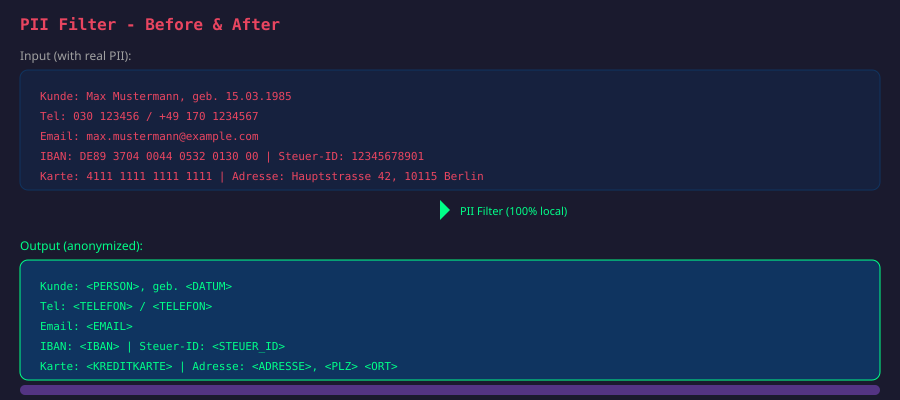
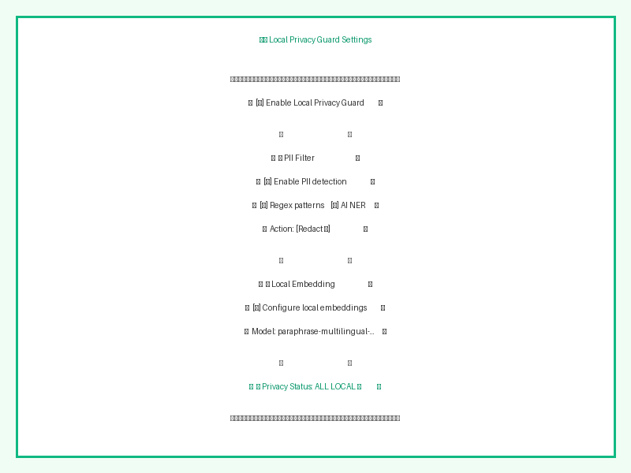
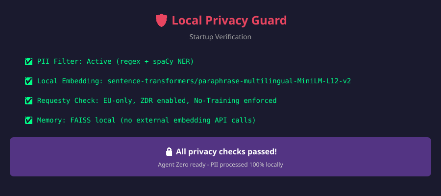

<div align="center">
  
  <h1>🛡️ Local Privacy Guard</h1>
  <p><b>Local personal-detail filtering and memory embeddings for Agent Zero</b></p>
</div>

[](https://github.com/agent0ai/agent-zero)
[](LICENSE)

---

## What does this plugin do?

### Standardschutz in 1.4.0

Native Chat-, Utility-, Browser-/Vision- und Kompaktierungsaufrufe werden am Modellwrapper geprüft. Alle Textblöcke, Systemtexte und Werkzeugergebnisse werden berücksichtigt, ohne die lokal sichtbare Eingabe zu überschreiben. Erforderliche, fehlende Namenserkennungsmodelle stoppen externe Textaufrufe. Erkannte Secrets in Modellinhalten werden lokal blockiert; Transport-Credentials werden nicht als Promptinhalt behandelt.

Ollama ist keine Nutzungsvoraussetzung. Ein geschütztes Profil kann ausschließlich zugelassene Requesty-Modelle verwenden. Lokale Textfilter und sentence-transformers-Embeddings benötigen keinen lokalen Chat-LLM. Ollama dient hier nur als optionale Modellroute und als vorhandene Entwicklungs-Testumgebung; Tesseract ist ebenfalls optional.

Redact-Modus verwendet eindeutige, persistente Tokenfamilien pro Schutzprofil und Chat. Schreibweisen und eindeutige Kurzformen können Varianten derselben Familie erhalten. Zuordnungen enthalten Originaldaten und liegen unter `usr/privacy-mappings` mit eingeschränkten Dateirechten. Die historische Option `store_mapping` bleibt lesbar, steuert aber nicht mehr die verbindliche Runtime-Zuordnung. Alte mehrdeutige Typ-Platzhalter werden nicht importiert.

Antworten und Denktext bleiben kanonisch maskiert. Die WebUI übersetzt für die Anzeige lokal zurück; native Werkzeugargumente werden ebenfalls lokal zurückübersetzt. Werkzeuge können diese Daten anschließend selbst an Webseiten oder andere Empfänger senden. Streaming-Ausgaben werden zunächst gepuffert und geprüft, wodurch die Anzeige später erscheint. Eine sichere verschlüsselte Ablage oder vollständige Anonymisierung wird nicht zugesagt.

Bilder dürfen über zugelassene Modelle verarbeitet werden. Ihr Inhalt wird nicht durch die Textmaskierung geschützt. Der Chat zeigt bei externen Bildaufrufen einen Hinweis mit der erfassten Modellroute. Optionales lokales OCR mit installiertem Tesseract liest Text aus einer ausgewählten Datei, verändert aber das Originalbild nicht. Browser, Formulare, Uploads und Dateibearbeitung erhalten keine neuen allgemeinen Einschränkungen.

Siehe [Standardschutz und gehärteter Ausblick](docs/STANDARD-AND-HARDENED-PLAN.md). Die historischen Abschnitte zu 1.2/1.3 und Screenshots beschreiben ältere Entwicklungsstände; die obigen Angaben sind für die aktuelle Modellprüfung maßgeblich.

Local Privacy Guard reduces the disclosure of detected personal details when using Agent Zero with external LLM APIs. It combines three privacy measures into one plugin:

| Feature | Description |
|---------|-------------|
| 🔒 **PII Filter** | Replaces detected personal details in supported chat and utility model calls, with multilingual detection. Detection can miss details. |
| 🧠 **Local Embedding** | Configures local sentence-transformers calculations for memory search. Helper models can still receive recalled memory text. |
| ✅ **Privacy Verification** | Checks selected configuration components on agent initialization; it does not audit all external data paths. |

### Related plugin

This plugin pairs with [Requesty Privacy Guard](https://github.com/mgr-de/a0-requesty-privacy-guard). Local Privacy Guard replaces detected details in supported model calls and configures local embeddings. Requesty Privacy Guard checks selected routing and provider data requirements against catalog metadata. Neither plugin independently audits provider practices or protects every tool, image or third-party data path.

### Settings in version 1.2.0

The settings page separates everyday choices from advanced detection and startup options. Its summary describes the selected project/profile configuration, not verified protection of an active chat. Save changes and restart after changing languages or the embedding model.

**Run local example** uses the real built-in filter on a fixed artificial email example. It makes no external model requests, downloads no models, saves no settings and creates no placeholder mapping. Results reflect the settings in the form, including unsaved changes; changed settings invalidate the displayed result. Missing name-detection models are reported separately. Install the needed spaCy models before relying on name detection. This example does not test custom patterns, embeddings or complete detection.

The original screenshots below predate the 1.2.0 settings redesign. See [the UI review](docs/UI-REVIEW.md) for the design rationale and acceptance criteria.

### Profile isolation in 1.3.0

Save configuration for one explicit Agent profile, optionally within a project. Settings inherited from a global or project-only installation cannot activate protection. The profile selection and disabled global form are visible in the settings page.

Local embedding settings are applied to the resolved configuration at runtime; startup never writes shared model presets. PII filter instances are owned by the actual Agent object and recreated after configuration changes. Weak references prevent a recycled object identifier from reusing another agent’s filter.

Protected profiles use a separate Memory folder, identified by project/profile and local embedding settings. Existing shared memories are preserved and are not copied automatically. Conflicting chat model overrides are rejected before an external embedding can be used. Startup checks describe this profile only.

Uninstall never restores shared presets automatically. Legacy backup journals remain available for deliberate manual recovery. Installation of Python/spaCy models is shared instance administration and may download model packages; runtime detection is local. Native global toggles and uninstall affect the entire instance. Use the profile toolbar toggle for a profile-only change. Native uninstall/ZIP replacement can remove scoped config files; back up configuration first.

Agent Zero profiles are not process or filesystem security sandboxes. These changes prevent this plugin from accidentally rewriting another profile’s configuration or memory index; they cannot restrict arbitrary third-party tools or an administrator. See [profile scope review](docs/PROFILE-SCOPE-REVIEW.md).

## Why is this needed?

Gateway-side PII scanning takes place after the original request reaches the gateway. Local filtering instead replaces detected details on your device before supported requests are sent. This reduces disclosure risk; it does not guarantee complete anonymization. Regex and name detection can miss short names, aliases, spelling changes and indirectly identifying context.

Requesty now documents Fast and model-based ML PII scanners for standard and Enterprise plans. Report forwards content unchanged; Mask replaces detected values before the model provider receives them. Its hosted scanner is an optional additional layer, not a substitute for local filtering. A claim of higher accuracy needs comparative tests. See [Requesty Guardrails](https://docs.requesty.ai/features/guardrails).

Similarly, Agent Zero's default memory embedding configuration may use external API endpoints. This plugin ensures embeddings are computed entirely on your machine.

---

## 📸 Screenshots

| Architecture Overview | PII Filter Demo |
|:---:|:---:|
|  |  |

| Plugin Settings | Startup Verification |
|:---:|:---:|
|  |  |

The PII filter supports **multiple languages simultaneously**. Select which languages to load in the plugin settings:

| Language | Code | spaCy Model | Special PII Types |
|----------|------|-------------|-------------------|
| 🇬🇧 **English** | `en` | `en_core_web_sm` | **Always loaded** (base requirement) |
| 🇩🇪 Deutsch | `de` | `de_core_news_sm` | Steuer-ID, German addresses |
| 🇫🇷 Français | `fr` | `fr_core_news_sm` | NIR (Social Security), SIREN (Company ID) |
| 🇪🇸 Español | `es` | `es_core_news_sm` | DNI (National ID) |
| 🇮🇹 Italiano | `it` | `it_core_news_sm` | Codice Fiscale (Tax Code) |
| 🇳🇱 Nederlands | `nl` | `nl_core_news_sm` | — |
| 🇵🇹 Português | `pt` | `pt_core_news_sm` | — |
| 🇵🇱 Polski | `pl` | `pl_core_news_sm` | — |

> ⚠️ **Note**: Each additional language requires its spaCy model (~50-100 MB RAM). Select only languages you actually need.

---

## How it works

The historical diagram illustrates detected-detail replacement and local embedding calculations. Version 1.4 also filters system texts and recalled memory in supported native model requests. Tools, original images and independent third-party model clients remain outside text masking. Replaced details do not make the remaining text necessarily anonymous.

```
┌─────────────────────────────────────────────────────────────┐
│                    YOUR LOCAL MACHINE                        │
│  ┌─────────────────────────────────────────────────────┐    │
│  │              Agent Zero (Docker Container)           │    │
│  │                                                      │    │
│  │  ┌─────────────┐    ┌──────────────┐    ┌────────┐  │    │
│  │  │ PII Filter  │───▶│   Filtered   │───▶│ Memory │  │    │
│  │  │(regex+NER)  │    │    Text      │    │ (FAISS)│  │    │
│  │  └─────────────┘    └──────────────┘    └────────┘  │    │
│  │         │                                    ▲       │    │
│  │         │                            ┌───────┴──────┐│    │
│  │         │                            │   Embedding  ││    │
│  │         │                            │   100% local ││    │
│  │         │                            │  (sentence-  ││    │
│  │         │                            │  transformers)│   │
│  │         │                            └──────────────┘│    │
│  │         ▼                                           │    │
│  │  ┌─────────────────────────────────────────────┐    │    │
│  │  │      Detected details replaced in text      │    │    │
│  │  │    "<PERSON>", "<EMAIL>" instead of real PII   │    │    │
│  │  └─────────────────────────────────────────────┘    │    │
│  └─────────────────────────────────────────────────────┘    │
│                              │                              │
│                              ▼                              │
│                    ┌─────────────────┐                      │
│                    │   INTERNET      │                      │
│                    └─────────────────┘                      │
└─────────────────────────────────────────────────────────────┘
```

---

## Installation

### From Plugin Hub (recommended)
1. Open Agent Zero WebUI → **Settings** → **Plugins**
2. Search for **"Local Privacy Guard"**
3. Click **Install**
4. Enable the plugin
5. Select your languages in the plugin settings

### Manual Installation
```bash
# Copy plugin to Agent Zero
cp -r local_privacy_guard /a0/usr/plugins/

# Install spaCy language models (English is required, add others as needed)
/opt/venv-a0/bin/python -m spacy download en_core_web_sm  # REQUIRED (base)
/opt/venv-a0/bin/python -m spacy download de_core_news_sm  # German
# /opt/venv-a0/bin/python -m spacy download fr_core_news_sm  # French
# /opt/venv-a0/bin/python -m spacy download es_core_news_sm  # Spanish
# /opt/venv-a0/bin/python -m spacy download it_core_news_sm  # Italian

# Restart Agent Zero
```

---

## Configuration

Go to **Settings** → **Plugins** → **Local Privacy Guard** to configure:

### PII Filter Settings

| Setting | Default | Description |
|---------|---------|-------------|
| `enabled` | `true` | Master switch for PII filtering |
| `use_regex` | `true` | Fast regex pattern matching |
| `use_ner` | `true` | AI-based Named Entity Recognition (spaCy) |
| `action` | `redact` | What to do: `redact` (replace), `block` (stop message), `log_only` (just log) |
| `languages` | `["de"]` | **List of languages** to load. English (`en`) is **always included automatically** |
| `log_detections` | `true` | Log detected PII to agent log |
| `store_mapping` | `true` | Legacy compatibility key; runtime redact mode always persists chat-owned mappings for local display |

### Local Embedding Settings

| Setting | Default | Description |
|---------|---------|-------------|
| `enabled` | `true` | Configure local embeddings |
| `model` | `paraphrase-multilingual-MiniLM-L12-v2` | sentence-transformers model (multilingual, 384 dims) |
| `auto_configure` | `true` | Apply local embedding settings to this profile at runtime; shared presets are unchanged |
| `verify_local` | `true` | Verify embedding runs locally |

### Detected PII Types

The plugin attempts to detect these categories and replaces detected values in redact mode:

| Category | Types |
|----------|-------|
| **Contact** | Email addresses, phone numbers (DE/FR/ES/IT/EN/INTL) |
| **Financial** | IBAN (all EU), credit cards, API keys |
| **Identity** | Names (NER), passport numbers, Steuer-ID (DE), DNI (ES), NIR (FR), Codice Fiscale (IT) |
| **Location** | Addresses (DE/EN/FR/ES/IT), postal codes, IP addresses |
| **Dates** | Dates (multiple formats) |
| **Technical** | URLs (with sensitive params), UUIDs, secrets |
| **Organizations** | Company names (NER) |

---

## Usage

Choose an explicit Agent profile in the settings toolbar, enable protection and save settings for it. Global/project-only settings do not activate protection. Once configured for that profile, the plugin works **automatically**:

1. On **supported native model calls**, all text blocks, system messages and tool results are scanned using the configured local detection methods
2. In **redact mode**, detected details receive unique chat-owned tokens; block mode stops detected requests, and log-only mode sends details unchanged
3. Text with **detected details replaced** is sent on supported calls in redact mode; missed details can remain
4. **Memory embeddings** are computed locally when configured successfully; recalled memory text can still be sent to a helper model

### Example

Original details remain readable in the local browser. The relevant privacy boundary is the outgoing model request. Version 1.4 uses persistent unique placeholders and restores replies for local display. Model replies can still invent identities, damage placeholders or confuse relationships; detection is imperfect. The older type-token example below is illustrative only. See [current test results](docs/STANDARD-TEST-RESULTS.md) and [the historical comparison](docs/PII-TEST-RESULTS.md).

**You type:**
> "Mein Name ist Anna Müller, meine E-Mail ist anna@example.com und meine IBAN ist DE89 3704 0044 0532 0130 00"

**Sent to LLM:**
> "Mein Name ist <PERSON>, meine E-Mail ist <EMAIL> und meine IBAN ist <IBAN>"

---

## Requirements

- Agent Zero (latest version)
- Python packages: `spacy`, `sentence-transformers` (installed automatically)
- spaCy language models:
  - `en_core_web_sm` — **required** (always loaded)
  - Additional models based on your language selection (downloaded on install)

---

## Privacy & Security

- 🏠 **100% local processing** — no data is sent to external services for PII detection
- ✅ **No telemetry** — the plugin does not phone home
- 🔌 **No external API calls** — all detection and embedding is done locally
- ✅ **Open source** — audit the code yourself
- ⚠️ **Local mappings** — redact mode stores original details in chat-owned mapping files. Protect and back up local storage; the legacy `store_mapping` flag does not disable runtime persistence.

---

## Troubleshooting

### spaCy model not found
```bash
/opt/venv-a0/bin/python -m spacy download en_core_web_sm  # Always needed
/opt/venv-a0/bin/python -m spacy download de_core_news_sm  # If German enabled
```

### Embedding still uses external API
Check this profile’s plugin settings. Runtime embedding resolution uses its configured `sentence-transformers/` model without rewriting shared presets. Conflicting per-chat embedding overrides are blocked; clear the override or select matching local embeddings.

### Plugin not loading
1. Check Agent Zero logs for errors
2. Verify plugin is enabled in Settings → Plugins
3. Restart Agent Zero

### Language not working
- Verify the spaCy model is installed: `/opt/venv-a0/bin/python -m spacy info <model_name>`
- Restart Agent Zero after changing languages

---

## License

MIT License — see [LICENSE](LICENSE) for details.

---

## Contributing

Contributions are welcome! Please open an issue or pull request on GitHub.

### Adding a new language

To add support for a new language:
1. Add the spaCy model to `SPACY_MODEL_NAMES` in `helpers/pii_detector.py`
2. Add label mapping to `LABEL_MAPS`
3. Create language-specific patterns (e.g., `FRENCH_PATTERNS`) and add to `LANGUAGE_PATTERNS`
4. Add the spaCy model to `hooks.py` for auto-installation
5. Add the language checkbox to `webui/config.html`

## Current standard-protection validation

See [1.4 / 0.4 test results](docs/STANDARD-TEST-RESULTS.md) for native routes, multilingual sessions, secrets, inherited subordinate policy, images and the partly manual form test. Historical comparison reports describe earlier code. Installation/update hooks create owned native adapters for inherited policies, with ownership journals outside the plugin ZIP; restart Agent Zero after installation/update. Independent other-profile chats are unaffected. Ollama is optional and checked for actual local weights only when selected; Requesty-only use needs no Ollama server. Full mappings contain local original values; malformed/truncated model tokens cannot reliably be restored, and truncated native chat titles use a neutral caption.
