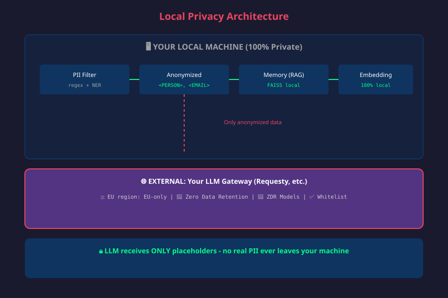

> **A0 Privacy Suite 0.9.3 - community beta.** Independently developed for local Agent Zero installations. Not a Requesty product; not affiliated with or endorsed by Requesty. Requesty is the external routing service used by the Model Gateway. All three components share version 0.9.3. Older numbers in historical reports document previous tests, not current requirements.
> **Agent Zero 2.14:** this branch includes the required Responses-history extras correction. Published 0.9.3 archives predate it. See [compatibility validation](docs/A0-2.14-COMPATIBILITY.md) before upgrading A0.

<div align="center">
  
  <h1>🛡️ A0 Privacy Suite - Local Guard</h1>
  <p><b>Local personal-detail filtering and memory embeddings for Agent Zero</b></p>
</div>

[](https://github.com/agent0ai/agent-zero)
[](LICENSE)

---

## What does this plugin do?

Version **0.9.3** retains local code recognition to the fixed spaCy/Regex detector. Supported source syntax and identifiers remain intact; comments, string literals, recognizable contacts and secrets continue to be checked. See [code handling and its limits](docs/CODE-FILTERING.md).

With A0 Privacy Suite - Manager **0.9.3**, an instance operator can explicitly grant **new Developer chats** an exception from PII masking. The default stays masked. Secret checks, existing Requesty routes and local embeddings remain required; the Secret-only path uses no spaCy model or historical mapping. Supported outgoing text, tool/function payloads and responses retain Secret screening and buffered output. PII tokenization and local tool/display restoration are skipped. Old chats and protected Memory are not migrated; Developer Memory has its own project/profile-generation/mode identity.

Each unmasked provider attempt is reauthorized at the native LiteLLM dispatch boundary after rate limiting; internal provider retries are disabled. Revocation blocks further calls of that chat, including subordinate calls. Already admitted calls may finish in their original output mode with mandatory Secret checks. Changed profile/project, imported policy or missing authority block further calls; regrant never reactivates old receipts. This exception can transmit personal data from the **entire model context** without masking. Image, browser, raw-tool network and filesystem protection retain their existing limits. [Operator setup](https://github.com/mgr-de/a0-requesty-privacy-agent#developer-ohne-maskierung).

### Standardschutz in 0.9.3

Native Chat-, Utility-, Browser-/Vision- und Kompaktierungsaufrufe werden am Modellwrapper geprüft. Alle Textblöcke, Systemtexte und Werkzeugergebnisse werden berücksichtigt, ohne die lokal sichtbare Eingabe zu überschreiben. Erforderliche, fehlende Namenserkennungsmodelle stoppen externe Textaufrufe. Erkannte Secrets in Modellinhalten werden lokal blockiert; Transport-Credentials werden nicht als Promptinhalt behandelt.

Mit aktivem Requesty-Schutz müssen externe Modelle dessen Anforderungen erfüllen. Native lokale Modellrouten bleiben zulässig. Lokale Textfilter und sentence-transformers-Embeddings benötigen keinen lokalen Chat-LLM. Es wird keine dienstspezifische Integration für den lokalen Entwicklungs-Testserver eingebaut; Tesseract bleibt optional.

Redact-Modus verwendet eindeutige, persistente Tokenfamilien pro Schutzprofil und Chat. Schreibweisen und eindeutige Kurzformen können Varianten derselben Familie erhalten. Zuordnungen enthalten Originaldaten und liegen unter `usr/privacy-mappings` mit eingeschränkten Dateirechten. Die historische Option `store_mapping` bleibt lesbar, steuert aber nicht mehr die verbindliche Runtime-Zuordnung. Alte mehrdeutige Typ-Platzhalter werden nicht importiert.

Antworten und Denktext bleiben kanonisch maskiert. Die WebUI übersetzt für die Anzeige lokal zurück; native Werkzeugargumente werden ebenfalls lokal zurückübersetzt. Werkzeuge können diese Daten anschließend selbst an Webseiten oder andere Empfänger senden. Streaming-Ausgaben werden zunächst gepuffert und geprüft, wodurch die Anzeige später erscheint. Eine sichere verschlüsselte Ablage oder vollständige Anonymisierung wird nicht zugesagt.

Bilder dürfen über zugelassene Modelle verarbeitet werden. Ihr Inhalt wird nicht durch die Textmaskierung geschützt. Der Chat zeigt bei externen Bildaufrufen einen Hinweis mit der erfassten Modellroute. Optionales lokales OCR mit installiertem Tesseract liest Text aus einer ausgewählten Datei, verändert aber das Originalbild nicht. Browser, Formulare, Uploads und Dateibearbeitung erhalten keine neuen allgemeinen Einschränkungen.

Siehe [Standardschutz und gehärteter Ausblick](docs/STANDARD-AND-HARDENED-PLAN.md). Die historischen Abschnitte zu 1.2/1.3 und Screenshots beschreiben ältere Entwicklungsstände; die obigen Angaben sind für die aktuelle Modellprüfung maßgeblich.

A0 Privacy Suite - Local Guard reduces the disclosure of detected personal details when using Agent Zero with external LLM APIs. It combines three privacy measures into one plugin:

| Feature | Description |
|---------|-------------|
| 🔒 **PII Filter** | Replaces detected personal details in supported chat and utility model calls, with multilingual detection. Detection can miss details. |
| 🧠 **Local Embedding** | Configures local sentence-transformers calculations for memory search. Helper models can still receive recalled memory text. |
| ✅ **Privacy Verification** | Checks selected configuration components on agent initialization; it does not audit all external data paths. |

### Related plugin

This plugin pairs with [A0 Privacy Suite - Model Gateway](https://github.com/mgr-de/a0-requesty-privacy-guard). A0 Privacy Suite - Local Guard replaces detected details in supported model calls and configures local embeddings. A0 Privacy Suite - Model Gateway checks selected routing and provider data requirements against catalog metadata. Neither plugin independently audits provider practices or protects every tool, image or third-party data path.

### Settings

The settings page separates everyday choices from advanced detection and startup options. Its summary describes the selected project/profile configuration, not verified protection of an active chat. Save changes and restart after changing languages or the embedding model.

**Run local example** uses the real built-in filter on a fixed artificial email example. It makes no external model requests, downloads no models, saves no settings and creates no placeholder mapping. Results reflect the settings in the form, including unsaved changes; changed settings invalidate the displayed result. Missing name-detection models are reported separately. Install the needed spaCy models before relying on name detection. This example does not test custom patterns, embeddings or complete detection.

The original screenshots below predate the 1.2.0 settings redesign. See [the UI review](docs/UI-REVIEW.md) for the design rationale and acceptance criteria.

### Profile isolation

Save configuration for one explicit Agent profile, optionally within a project. Settings inherited from a global or project-only installation cannot activate protection. The profile selection and disabled global form are visible in the settings page.

Local embedding settings are applied to the resolved configuration at runtime; startup never writes shared model presets. PII filter instances are owned by the actual Agent object and recreated after configuration changes. Weak references prevent a recycled object identifier from reusing another agent’s filter.

Protected profiles use a separate Memory folder, identified by project/profile and local embedding settings. Existing shared memories are preserved and are not copied automatically. Conflicting chat model overrides are rejected before an external embedding can be used. Startup checks describe this profile only.

Uninstall never restores shared presets automatically. Legacy backup journals remain available for deliberate manual recovery. Installation of Python/spaCy models is shared instance administration and may download model packages; runtime detection is local. Native global toggles and uninstall affect the entire instance. Use the profile toolbar toggle for a profile-only change. Native uninstall/ZIP replacement can remove scoped config files; back up configuration first.

Agent Zero profiles are not process or filesystem security sandboxes. These changes prevent this plugin from accidentally rewriting another profile’s configuration or memory index; they cannot restrict arbitrary third-party tools or an administrator. See [profile scope review](docs/PROFILE-SCOPE-REVIEW.md).

## Why is this needed?

Gateway-side PII scanning takes place after the original request reaches the gateway. Local filtering instead replaces detected details on your device before supported requests are sent. This reduces disclosure risk; it does not guarantee complete anonymization. Regex and name detection can miss short names, aliases, spelling changes and indirectly identifying context.

Requesty now documents Fast and model-based ML PII scanners for standard and Enterprise plans. Report forwards content unchanged; Mask replaces detected values before the model provider receives them. Its hosted scanner is an optional additional layer, not a substitute for local filtering. A claim of higher accuracy needs comparative tests. See [Requesty Guardrails](https://docs.requesty.ai/features/guardrails).

Similarly, Agent Zero's default memory embedding configuration may use external API endpoints. This plugin ensures embeddings are computed entirely on your machine.

---

## 📸 Screenshots

| Architecture Overview | PII Filter Demo |
|:---:|:---:|
|  |  |

| Plugin Settings | Startup Verification |
|:---:|:---:|
|  |  |

The PII filter supports **multiple languages simultaneously**. Select which languages to load in the plugin settings:

| Language | Code | spaCy Model | Special PII Types |
|----------|------|-------------|-------------------|
| 🇬🇧 **English** | `en` | `en_core_web_sm` | **Always loaded** (base requirement) |
| 🇩🇪 Deutsch | `de` | `de_core_news_sm` | Steuer-ID, German addresses |
| 🇫🇷 Français | `fr` | `fr_core_news_sm` | NIR (Social Security), SIREN (Company ID) |
| 🇪🇸 Español | `es` | `es_core_news_sm` | DNI (National ID) |
| 🇮🇹 Italiano | `it` | `it_core_news_sm` | Codice Fiscale (Tax Code) |
| 🇳🇱 Nederlands | `nl` | `nl_core_news_sm` | — |
| 🇵🇹 Português | `pt` | `pt_core_news_sm` | — |
| 🇵🇱 Polski | `pl` | `pl_core_news_sm` | — |

> Each additional language requires its spaCy model and additional memory. Actual memory use depends on the loaded models and workload. Select only languages you need.

---

## How it works

The historical diagram illustrates detected-detail replacement and local embedding calculations. Version 1.4 also filters system texts and recalled memory in supported native model requests. Tools, original images and independent third-party model clients remain outside text masking. Replaced details do not make the remaining text necessarily anonymous.

```
┌─────────────────────────────────────────────────────────────┐
│                    YOUR LOCAL MACHINE                        │
│  ┌─────────────────────────────────────────────────────┐    │
│  │              Agent Zero (Docker Container)           │    │
│  │                                                      │    │
│  │  ┌─────────────┐    ┌──────────────┐    ┌────────┐  │    │
│  │  │ PII Filter  │───▶│   Filtered   │───▶│ Memory │  │    │
│  │  │(regex+NER)  │    │    Text      │    │ (FAISS)│  │    │
│  │  └─────────────┘    └──────────────┘    └────────┘  │    │
│  │         │                                    ▲       │    │
│  │         │                            ┌───────┴──────┐│    │
│  │         │                            │   Embedding  ││    │
│  │         │                            │   100% local ││    │
│  │         │                            │  (sentence-  ││    │
│  │         │                            │  transformers)│   │
│  │         │                            └──────────────┘│    │
│  │         ▼                                           │    │
│  │  ┌─────────────────────────────────────────────┐    │    │
│  │  │      Detected details replaced in text      │    │    │
│  │  │    "<PERSON>", "<EMAIL>" instead of real PII   │    │    │
│  │  └─────────────────────────────────────────────┘    │    │
│  └─────────────────────────────────────────────────────┘    │
│                              │                              │
│                              ▼                              │
│                    ┌─────────────────┐                      │
│                    │   INTERNET      │                      │
│                    └─────────────────┘                      │
└─────────────────────────────────────────────────────────────┘
```

---

## Installation

### Local installation
1. Open Agent Zero WebUI → **Settings** → **Plugins**
2. Install the community beta package or use this repository through the native plugin installer.
3. Click **Install**
4. Enable the plugin
5. Select your languages in the plugin settings

### Manual Installation
```bash
# Copy plugin to Agent Zero
cp -r local_privacy_guard /a0/usr/plugins/

# Install spaCy language models (English is required, add others as needed)
/opt/venv-a0/bin/python -m spacy download en_core_web_sm  # REQUIRED (base)
/opt/venv-a0/bin/python -m spacy download de_core_news_sm  # German
# /opt/venv-a0/bin/python -m spacy download fr_core_news_sm  # French
# /opt/venv-a0/bin/python -m spacy download es_core_news_sm  # Spanish
# /opt/venv-a0/bin/python -m spacy download it_core_news_sm  # Italian

# Restart Agent Zero
```

---

## Configuration

Go to **Settings** → **Plugins** → **A0 Privacy Suite - Local Guard** to configure:

### PII Filter Settings

| Setting | Default | Description |
|---------|---------|-------------|
| `enabled` | `true` | Master switch for PII filtering |
| `use_regex` | `true` | Fast regex pattern matching |
| `use_ner` | `true` | AI-based Named Entity Recognition (spaCy) |
| `action` | `redact` | What to do: `redact` (replace), `block` (stop message), `log_only` (just log) |
| `languages` | `["de"]` | **List of languages** to load. English (`en`) is **always included automatically** |
| `log_detections` | `true` | Log detected PII to agent log |
| `store_mapping` | `true` | Legacy compatibility key; runtime redact mode always persists chat-owned mappings for local display |

### Local Embedding Settings

| Setting | Default | Description |
|---------|---------|-------------|
| `enabled` | `true` | Configure local embeddings |
| `model` | `paraphrase-multilingual-MiniLM-L12-v2` | sentence-transformers model (multilingual, 384 dims) |
| `auto_configure` | `true` | Apply local embedding settings to this profile at runtime; shared presets are unchanged |
| `verify_local` | `true` | Verify embedding runs locally |

### Detected PII Types

The plugin attempts to detect these categories and replaces detected values in redact mode:

| Category | Types |
|----------|-------|
| **Contact** | Email addresses, phone numbers (DE/FR/ES/IT/EN/INTL) |
| **Financial** | IBAN (all EU), credit cards, API keys |
| **Identity** | Names (NER), passport numbers, Steuer-ID (DE), DNI (ES), NIR (FR), Codice Fiscale (IT) |
| **Location** | Addresses (DE/EN/FR/ES/IT), postal codes, IP addresses |
| **Dates** | Dates (multiple formats) |
| **Technical** | URLs (with sensitive params), UUIDs, secrets |
| **Organizations** | Company names (NER) |

---

## Usage

Choose an explicit Agent profile in the settings toolbar, enable protection and save settings for it. Global/project-only settings do not activate protection. Once configured for that profile, the plugin works **automatically**:

1. On **supported native model calls**, all text blocks, system messages and tool results are scanned using the configured local detection methods
2. In **redact mode**, detected details receive unique chat-owned tokens; block mode stops detected requests, and log-only mode sends details unchanged
3. Text with **detected details replaced** is sent on supported calls in redact mode; missed details can remain
4. **Memory embeddings** are computed locally when configured successfully; recalled memory text can still be sent to a helper model

### Illustrative example

Original details remain readable in the local browser. The relevant privacy boundary is the outgoing model request. Version 1.4 uses persistent unique placeholders and restores replies for local display. Model replies can still invent identities, damage placeholders or confuse relationships; detection is imperfect. The older type-token example below is illustrative only. See [current test results](docs/STANDARD-TEST-RESULTS.md) and [the historical comparison](docs/PII-TEST-RESULTS.md).

**You type:**
> "Mein Name ist Anna Müller, meine E-Mail ist anna@example.com und meine IBAN ist DE89 3704 0044 0532 0130 00"

**Sent to LLM:**
> "Mein Name ist <PERSON>, meine E-Mail ist <EMAIL> und meine IBAN ist <IBAN>"

---

## Requirements

- Agent Zero 2.13 (the native integration tested here)
- Python packages: `spacy`, `sentence-transformers` (installed automatically)
- spaCy language models:
  - `en_core_web_sm` — **required** (always loaded)
  - Additional models based on your language selection (downloaded on install)

---

## Privacy & Security

- 🏠 **Local detection** — spaCy and Regex inspect text on your device; no hosted detector is used
- 🔌 **Local embeddings** — configured sentence-transformers embeddings run locally; installation/preparation may download packages and weights
- **Model requests** — remaining text can still be sent to the configured model service; local detection does not make that service local
- ✅ **Open source** — audit the code yourself
- ⚠️ **Local mappings** — redact mode stores original details in chat-owned mapping files. Protect and back up local storage; the legacy `store_mapping` flag does not disable runtime persistence.

---

## Troubleshooting

### spaCy model not found
```bash
/opt/venv-a0/bin/python -m spacy download en_core_web_sm  # Always needed
/opt/venv-a0/bin/python -m spacy download de_core_news_sm  # If German enabled
```

### Embedding still uses external API
Check this profile’s plugin settings. Runtime embedding resolution uses its configured `sentence-transformers/` model without rewriting shared presets. Conflicting per-chat embedding overrides are blocked; clear the override or select matching local embeddings.

### Plugin not loading
1. Check Agent Zero logs for errors
2. Verify plugin is enabled in Settings → Plugins
3. Restart Agent Zero

### Language not working
- Verify the spaCy model is installed: `/opt/venv-a0/bin/python -m spacy info <model_name>`
- Restart Agent Zero after changing languages

---

## License

MIT License — see [LICENSE](LICENSE) for details.

---

## Contributing

Contributions are welcome! Please open an issue or pull request on GitHub.

### Adding a new language

To add support for a new language:
1. Add the spaCy model to `SPACY_MODEL_NAMES` in `helpers/pii_detector.py`
2. Add label mapping to `LABEL_MAPS`
3. Create language-specific patterns (e.g., `FRENCH_PATTERNS`) and add to `LANGUAGE_PATTERNS`
4. Add the spaCy model to `hooks.py` for auto-installation
5. Add the language checkbox to `webui/config.html`

## Current standard-protection validation

See [the fixed-detector validation](docs/SINGLE-DETECTOR-VALIDATION.md), [current code handling](docs/CODE-FILTERING.md) and [historical 1.4 / 0.4 test results](docs/STANDARD-TEST-RESULTS.md) for native routes, multilingual sessions, secrets, inherited subordinate policy, images and the partly manual form test. Historical comparison reports describe earlier code. Installation/update hooks create owned native adapters for inherited policies, with ownership journals outside the plugin ZIP; restart Agent Zero after installation/update. Independent other-profile chats are unaffected. Local models remain native Agent Zero choices; no local-server metadata or weight checks are performed by these plugins. Full mappings contain local original values; malformed/truncated model tokens cannot reliably be restored, and truncated native chat titles use a neutral caption.

See [the 12 October correction](docs/KORREKTUR-2026-10-12.md): effective Requesty model labels replace misleading shared-default labels in protected chats, without changing presets. Provider-specific local-server probes were removed.

See [test environment and settings entry](docs/TEST-ENVIRONMENT.md) for the fixed Privacy Test profile, temporary isolation fixtures, and choosing an explicit profile before editing Requesty.


## Zuordnungen, Sprachprüfung und gemeinsamer Privacy Agent

Endgültige Chatlöschung über Agent Zeros `/api/chat_remove` entfernt die zugehörigen Zuordnungen und SQLite-Nebendateien. Archivierung behält sie. Config bietet außerdem eine ausdrücklich bestätigte Löschung nur der Zuordnungen; alte Platzhalter lassen sich danach nicht zurückübersetzen. Chattexte, Speicher, Sicherungen und externe Logs werden dadurch nicht entfernt.

Der synthetische [Sprachkorpus](tests/fixtures/multilingual_sessions.json) umfasst DE, EN, FR, ES, IT, NL, PL und gemischte Sitzungen mit vier Personen über 40 und 100 Nachrichten. [Der archivierte Vergleichsrunner](https://github.com/mgr-de/a0-local-privacy-guard/blob/archive/cpu-pii-evaluation-2026-10-13/tools/privacy_benchmark/language_sessions.py) bewertet Erkennung, Rückübersetzung, Tokenkontinuität, Kontextkürzung und Wiederöffnung von Zuordnungen. Er ist kein Test generierter Modellantworten und kein allgemeiner PII-Erkennungsnachweis. Erforderliche spaCy-Sprachmodelle müssen vorhanden sein; es wird kein lokaler Chat-LLM vorausgesetzt.

[A0 Privacy Suite - Manager](https://github.com/mgr-de/a0-requesty-privacy-agent) nutzt dieses Plugin für installationsweite Mindestregeln. Ohne aktivierten Manager bleibt die bestehende profilbezogene Nutzung erhalten. [Aktuelle Einführung und Grenzen](docs/INSTANCE-PRIVACY-PLAN.md).


## Native Requesty-Presets (Privacy Agent 0.2)

Der aktivierte Manager kann nach ausdrücklicher Migrationsvorschau A0s Default, Efficiency und Power auf geprüfte Requesty-EU-Modelle umstellen. Native Presets sind anschließend die einzige Quelle für Main, Utility und Vision; die Privacy-Policy und Schlüssel bleiben getrennt. Zulässige Modelländerungen im normalen A0-Preset-Editor erfordern keine Abschaltung. Der Provider ist Requesty, Embeddings bleiben auf dem eingerichteten lokalen Modell. Kurze Managed-Namen und mit einer Anbieterpräfix-Suche spezifische IDs bleiben möglich.

Neue Einrichtungen starten mit Default (Sol/Luna); Efficiency verwendet GLM/DeepSeek mit separatem DeepSeek-Vision-Modell, Power Opus/Luna. Diese Vorbelegung startet keine kostenpflichtigen Modelltests. Jede Migration validiert den aktuellen Katalog und verlangt Ersatz für fehlende Standardmodelle. Eine bereits ausdrücklich gewählte gemeinsame Einrichtung kann als eigenes natives Preset erhalten und ausgewählt bleiben. Vorhandene aktive Profilsetups werden als native Profil-Presets übertragen; Schlüssel werden nicht in Presets kopiert. Andere individuelle Presets bleiben erhalten, unzulässige davon gesperrt.

Sicherungen liegen ausschließlich lokal unter usr/privacy-agent/preset-backups. Veraltete Vorschauen werden abgelehnt. Eine fehlgeschlagene Übernahme stellt die vorherigen Presets und Zuordnungen wieder her. Die separate Wiederherstellung ist nach zentraler Deaktivierung möglich und verweigert das Überschreiben späterer Änderungen. Updates migrieren oder überschreiben Presets nicht automatisch. Erst nach Vorbereitung der Komponenten, bestätigter Migration und expliziter Aktivierung gelten die installationsweiten Regeln.

Die nativen Speicher- und Auswahladapter werden beim A0-Start eingerichtet, sind reversibel und verändern keine A0-Kerndateien. Direkte API-Eingaben werden ebenfalls geprüft; alte Modellwrapper mit abweichender Modellwahl müssen neu aufgebaut werden. Ohne Manager bleibt das eigenständige Verhalten dieses Plugins erhalten. Bildinhalte und beliebige Werkzeugübertragungen bleiben außerhalb der lokalen Textmaskierung.

## Fixed local detector and incremental filtering

Version 0.9.3 ships one production detector: spaCy NER together with built-in and custom Regex rules. The 32 MiB / 15 minute process-local span cache, paragraph batching, transactional mappings, secret checks and separate input/model/output timing remain in place. Existing tokens and saved profile settings are retained.

Backend selection and optional model-package installation have been removed from Advanced settings. Old `backend: presidio` or `backend: nym` settings are interpreted by the fixed local detector; their files are not rewritten. Unknown backend values still fail validation. Other detectors are not loaded, downloaded or used as fallbacks.

Detector experiments, comparison tools and measurement reports are preserved on [archive/cpu-pii-evaluation-2026-10-13](https://github.com/mgr-de/a0-local-privacy-guard/tree/archive/cpu-pii-evaluation-2026-10-13). This is a reference branch, not an install/update branch. The product decision retains the already tested multilingual pipeline and controlled native browser behavior. [Performance and limits](docs/FILTER-PERFORMANCE.md).

For primarily local installations without external access, Manager 0.3.1 makes the interface login optional but strongly recommends it. Anyone who can access an unauthenticated interface can manage profile exceptions. A configured login still requires an authenticated session; explicit full-context consent and native CSRF remain required.

## Suite versioning and existing installations

All three components use the same suite version. 0.9.3 starts the unified community beta numbering and replaces the former Local Guard 1.9.0, Model Gateway 0.6.1 and Manager 0.3.3; it does not remove their functionality. Patch versions (0.9.x) cover fixes, later 0.x minor versions cover feature or compatibility changes, and 1.0 is reserved for a separately decided stable release. Versions below 1.0 do not promise a stable public API. Update all three components together through the native Git plugin updater and restart Agent Zero; older Local Guard metadata has a higher number, so an installer that refuses downgrades may require the explicit Git update. Do not uninstall or delete user data to change the name. Existing internal IDs, repository URLs, keys, mappings and stored presets remain valid. Historical tags and reports remain unchanged; new packages are marked as pre-releases.

## Community beta 0.9.3: compatibility and installation

Test target: Agent Zero 2.13 on Linux Docker, framework Python 3.12, CPU-only privacy detection. The exact image/framework commit and observed cold-install/download measurements are recorded in `docs/COMMUNITY-BETA-VALIDATION.md`. Other versions and deployment types have not been certified. This is independent community software, not an official Requesty product.

Install all three components on the same version through the native Plugin Hub, Git or the published ZIPs. Start with the Manager; its configuration provides an explicit button to install missing pinned companion packages. Installation does not activate central policy and does not invoke a paid model. Configure the Requesty key/routing and local languages deliberately before activating. Restart A0 after all component updates. An active policy must be deactivated centrally before using ordinary plugin-disable or uninstall actions; profile toggles cannot override it.

Local Guard downloads missing English/German spaCy models during installation. Additional languages require their corresponding model downloads. The configured local embedding model (`sentence-transformers/paraphrase-multilingual-MiniLM-L12-v2`) may download on first use; model files need disk space and network access during setup, then inference is local. Ollama is optional and is not used by the PII detector. CPU time and memory depend on language models, text length and parallel chats; reserve additional host RAM/disk capacity and consult the measured beta report rather than treating development measurements as universal minimums. Missing required NER models block supported external calls.

See [security reporting and deployment limits](SECURITY.md). Current beta screenshots and test scope are linked in the validation report. No claim of complete anonymization or unrestricted protection of images/tools is made.

## Activation state and recovery (0.9.3)

The ordinary plugin toggle does not override an active central policy. The Manager shows plugin enablement, central activation and integrity of its own native adapters separately. A boolean `active: false` in the state file represents deliberate central deactivation. A new installation with no activation history is unconfigured. Invalid/missing activation fields, unreadable JSON, unsafe paths, or a missing `active.json` where an activation record or Manager ownership journal remains are errors: supported enforcement paths block rather than interpreting this as intentional disablement. An activation receipt contains only schema/managed status, no keys, PII or mappings.

Restore damaged `usr/privacy-agent/active.json` (and a damaged activation record, if present) from a trusted backup with its original state; do not replace it with an empty object, string or guessed `false` to clear an error. No automatic activation/deactivation is performed by repair. Keep model requests paused during maintenance; then restart A0 and check central status before use. The plugin is not an access-control boundary against an administrator who deliberately deletes all state and enforcement files.

For intact activation state, use **Eigene Prüfhaken wiederherstellen** to restore missing known Manager adapters; conflicting modified files require manual review and are not overwritten. After explicit central deactivation, **Inaktive Prüfhaken bereinigen** removes only hash-matching owned files and preserves modified/foreign files and their ownership evidence. This maintenance and normal Manager uninstall do not require either companion plugin to be available. Keys, presets, profiles and mappings are retained. Restoring hooks does not reinstall companion plugins or models; complete those separately through the native installer.
